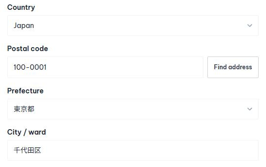

# AddressJP plugin — Japan Address

> 🌐 **Language:** [🇻🇳 Tiếng Việt](./readme_vi.md) · 🇬🇧 English (current) · [🇯🇵 日本語](./readme_ja.md)

Customers in Japan type their **postal code** (郵便番号) and the **prefecture** (都道府県), **city / ward** (市区町村) and **town**
(町域) fill in — they only add the block number and building. This is how people in Japan expect to enter an address when they
shop online, now on your S-Cart store.

The postal code data is the official file of **Japan Post**, shipped inside the plugin: no outside service is called, no
Internet connection or cron is needed, and no customer data leaves your site.

---

## Overview

| | |
| --- | --- |
| **Plugin** | AddressJP |
| **Version** | 1.0.0 |
| **Developer** | GP247 |
| **License** | Free · open source, [MIT](./LICENSE) |
| **Requires** | GP247 Core **3.18+** · package `gp247/shop` **3.15.1+** |
| **Not needed** | New Composer packages, cron, queue, an Internet connection at run time |
| **Data** | 47 prefectures · 120,721 postal codes — Japan Post file of **2026-10-23** |

## Features

- The **Postal code** field accepts every usual way of typing it: `100-0001`, `1000001`, full-width `１００－０００１`, with a
  leading `〒`.
- A postal code with one town fills Prefecture, City / ward and Town at once; with several towns the customer picks one; not
  found — the customer is told and the fields stay open for typing.
- After the fill, the customer keeps typing the block number (番地) and building in the same Town field — the address keeps its
  codes.
- No postal code at hand: pick the **Prefecture** from the list of 47 (with search) and type the rest.
- Stores the postal code as `NNN-NNNN` and the **official names** of prefecture, city / ward and town with the **prefecture and
  local government codes** (JIS), for shipping plugins and reports. A postal code that
  does not belong to the chosen prefecture, or has the wrong number of digits, is flagged on the Postal code field.
- Works wherever an address is entered: registration, account details, address book, checkout; and in admin: order edit,
  order create, customers, a customer's address book.
- Place names stay in Japanese in every interface language (a delivery address in Japan is written in Japanese); field labels
  follow the language.
- Customers in other countries type their address as before. If the data is missing or damaged the fields turn back into plain
  inputs — customers can still order.
- On / off per store (multi-store sites).

## Installation

1. Copy the `AddressJP` folder to `app/GP247/Plugins/` on your website (or upload the ZIP file at
   **Admin → Extensions / Plugins → Import**).
2. Go to **Admin → Extensions / Plugins**, find **Japan Address** and click **Install**.

The plugin is enabled right after installation. A site not yet on `gp247/shop` 3.15 gets a message to update S-Cart first
(`composer update`, then `php artisan gp247:update`).

## Configuration

Click the plugin's settings button, or go to **Shop setting → Address lists** and choose **Japan**. Defaults:

| The plugin provides | Fills the field |
| --- | --- |
| Postal code (郵便番号) | Post code — placed right after Country |
| Prefecture (都道府県) | City / Province |
| City / ward (市区町村) | District |
| Town (町域) | Main address — the customer adds the block number and building |

The check panel at the top lists anything still missing, with a button to the place to fix it. The usual one: on **Website
configuration → Customer tab**, **switch on** the Post code, City / Province, District and Country fields. If you switched
District off (for example because Vietnamese addresses no longer have districts), switch it back on or send City / ward to
another field — otherwise that part is not saved.

Uninstalling the plugin keeps the settings of this screen — reinstall and carry on.

## Updating the data

Japan Post updates its postal code data every month. Each plugin release states the date of its data (Overview table); when a
new release comes out, update the plugin like any other — saved addresses are not changed.

Maintainers rebuild the data with the command shipped in the plugin:

1. Download `utf_ken_all.zip` (住所の郵便番号 — 1レコード1行、UTF-8形式) from
   [Japan Post's postal code download page](https://www.post.japanpost.jp/zipcode/download.html).
2. From the website root: `php app/GP247/Plugins/AddressJP/tools/build-postcodes.php <utf_ken_all.zip> <YYYY-MM-DD>`
   (date of the file). The command stops without writing anything if a row looks wrong (column count, a code with the wrong
   number of digits, an unknown prefecture).

## Data source

| Source | Version / date | Used by the plugin for |
| --- | --- | --- |
| [Postal code data — Japan Post](https://www.post.japanpost.jp/zipcode/download.html), `utf_ken_all.zip` | 2026-10-23 · 47 prefectures, 120,721 postal codes, 124,527 rows | Postal codes, prefectures, cities / wards (JIS codes), towns (`Data/`) |

Japan Post claims no copyright on its postal code data and allows free redistribution. The plugin cleans town names for
customers: placeholder rows (`以下に掲載がない場合`…) become empty and notes in parentheses (`（１〜１９丁目）`, `（１階）`…) are
dropped.

## Release history

- **1.0.0** — First release: postal code lookup to prefecture, city / ward and town; list of 47 prefectures; official names
  stored with codes; Japan Post data of 2026-10-23.
