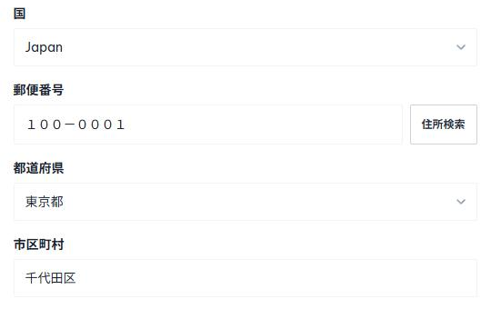
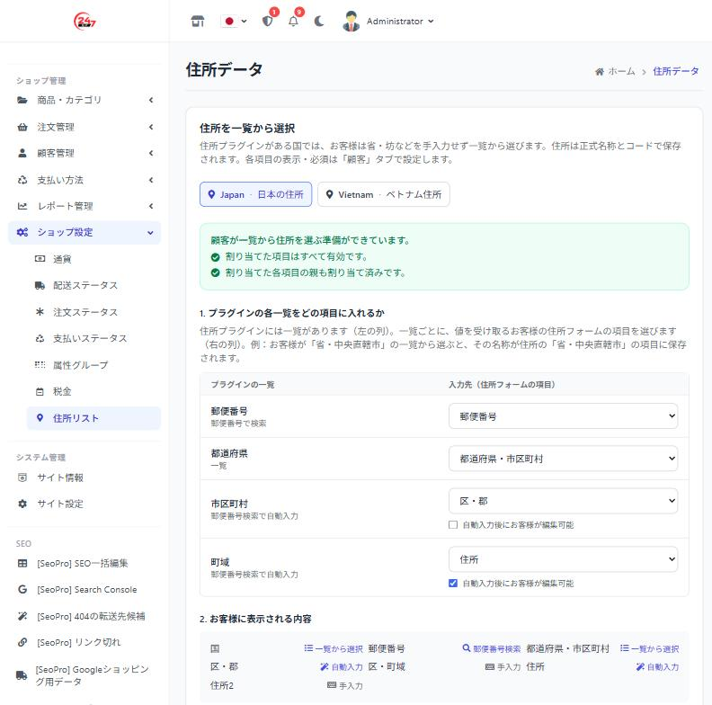

# AddressJP プラグイン — 日本の住所

> 🌐 **言語:** [🇻🇳 Tiếng Việt](./readme_vi.md) · [🇬🇧 English](./readme.md) · 🇯🇵 日本語（現在）

お客様が **郵便番号** を入力すると **都道府県**・**市区町村**・**町域** が自動で入力され、番地と建物名だけを入力すれば済みます。
日本のネットショッピングでおなじみの住所入力を、S-Cart のストアで使えるようにします。

郵便番号データは **日本郵便** の公式ファイルで、プラグインに同梱しています。外部サービスへの通信はなく、インターネット接続や
cron も不要で、お客様のデータが外部に送られることはありません。

---

## 概要

| | |
| --- | --- |
| **プラグイン** | AddressJP |
| **バージョン** | 1.0.0 |
| **開発者** | GP247 |
| **ライセンス** | 無料・オープンソース、[MIT](./LICENSE) |
| **必要環境** | GP247 Core **3.18 以降** · パッケージ `gp247/shop` **3.15.1 以降** |
| **不要なもの** | 追加の Composer パッケージ、cron、キュー、実行時のインターネット接続 |
| **データ** | 47 都道府県 · 郵便番号 120,721 件 — 日本郵便 **2026 年 10 月 23 日** 版 |

## 機能

- **郵便番号** 欄はよく使われる書き方をすべて受け付けます：`100-0001`、`1000001`、全角 `１００－０００１`、先頭の `〒`。
- 町域が 1 つの郵便番号なら都道府県・市区町村・町域をすぐに入力。複数ある場合はお客様が 1 つを選択。見つからない場合は
  その旨を表示し、各欄は手入力できます。
- 入力後、お客様は同じ町域の欄に続けて番地と建物名を入力できます。住所のコードはそのまま保持されます。
- 郵便番号がわからない場合は、47 都道府県の一覧（検索付き）から **都道府県** を選び、残りを手入力します。
- 郵便番号を `NNN-NNNN` 形式で、都道府県・市区町村・町域を **正式名称** と **都道府県コード・地方公共団体コード**（JIS）付きで
  保存します（配送プラグインやレポートで利用可能）。選んだ都道府県に属さない郵便番号や桁数の違う郵便番号は、郵便番号の欄でお知らせします。
- 住所を入力するすべての画面で動作します：会員登録、アカウント情報、住所録、注文手続き。管理画面では注文の編集・作成、
  顧客、顧客の住所録。
- 地名はどの表示言語でも日本語のままです（日本の配送先住所は日本語で書くため）。項目名は表示言語に従います。
- 他の国のお客様はこれまでどおり住所を手入力します。データがない・壊れている場合は通常の入力欄に戻り、注文は続けられます。
- ストアごとに有効・無効を切り替え可能（マルチストアのサイト）。

## インストール

1. `AddressJP` フォルダをサイトの `app/GP247/Plugins/` にコピーします（または **管理画面 → Extensions / Plugins → Import** で
   ZIP ファイルをアップロード）。
2. **管理画面 → Extensions / Plugins** で **日本の住所** を探し、**Install** をクリックします。

インストール後すぐに有効になります。`gp247/shop` 3.15 未満のサイトでは、先に S-Cart を更新するようメッセージが表示されます
（`composer update` のあと `php artisan gp247:update`）。

## 設定

プラグインの設定ボタンをクリックするか、**ショップ設定 → 住所リスト** で **日本** を選びます。既定は次のとおりです。

| プラグインの項目 | 入力先の欄 |
| --- | --- |
| 郵便番号 | 郵便番号 — 国の欄のすぐ後に表示 |
| 都道府県 | 都道府県・市区町村 |
| 市区町村 | 区・郡 |
| 町域 | 住所 — お客様が続けて番地・建物名を入力 |

画面上部のチェック欄に不足している設定と、修正する場所へのボタンが表示されます。よくあるのは **サイト設定 → 顧客タブ** で
「郵便番号」「都道府県・市区町村」「区・郡」「国」の欄を **有効** にすることです。区・郡の欄を無効にしている場合（ベトナムの住所に
郡がなくなったためなど）は、有効に戻すか市区町村を別の欄に割り当ててください。そうしないとその部分は保存されません。

プラグインをアンインストールしてもこの画面の設定は残ります。再インストールすればそのまま使えます。

## データの更新

日本郵便は郵便番号データを毎月更新しています。プラグインの各リリースにはデータの日付を記載しています（概要の表）。新しい
リリースが出たら、他のプラグインと同じように更新してください。保存済みの住所は変更されません。

メンテナーはプラグイン同梱のコマンドでデータを再作成します。

1. [日本郵便 郵便番号データダウンロード](https://www.post.japanpost.jp/zipcode/download.html) から
   `utf_ken_all.zip`（住所の郵便番号 — 1レコード1行、UTF-8形式）をダウンロードします。
2. サイトのルートで：`php app/GP247/Plugins/AddressJP/tools/build-postcodes.php <utf_ken_all.zip> <YYYY-MM-DD>`
   （ファイルの日付）。おかしな行（列数、桁数の違うコード、不明な都道府県）があると、何も書き込まずに停止します。

## データの出典

| 出典 | バージョン / 日付 | プラグインでの用途 |
| --- | --- | --- |
| [郵便番号データ — 日本郵便](https://www.post.japanpost.jp/zipcode/download.html)、`utf_ken_all.zip` | 2026 年 10 月 23 日 · 47 都道府県、郵便番号 120,721 件、124,527 行 | 郵便番号、都道府県、市区町村（JIS コード）、町域（`Data/`） |

日本郵便は郵便番号データの著作権を主張しておらず、自由に再配布できます。プラグインはお客様向けに町域名を整えています：
「以下に掲載がない場合」などの行は空欄にし、括弧内の注記（`（１〜１９丁目）`、`（１階）` など）は省いています。

## リリース履歴

- **1.0.0** — 初回リリース：郵便番号から都道府県・市区町村・町域を検索、47 都道府県の一覧、正式名称とコードを保存、
  日本郵便 2026 年 10 月 23 日版のデータ。
