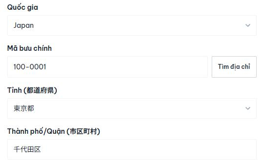

# Plugin AddressJP — Địa chỉ Nhật Bản

> 🌐 **Ngôn ngữ:** 🇻🇳 Tiếng Việt (hiện tại) · [🇬🇧 English](./readme.md) · [🇯🇵 日本語](./readme_ja.md)

Khách ở Nhật gõ **mã bưu chính** (郵便番号) là **Tỉnh** (都道府県), **Thành phố/Quận** (市区町村) và **Khu phố** (町域) tự điền
— chỉ còn gõ số nhà và tên toà nhà. Đúng cách người Nhật quen nhập địa chỉ khi mua hàng trực tuyến, áp dụng cho cửa hàng S-Cart.

Dữ liệu mã bưu chính là file chính thức của **Japan Post** (Bưu điện Nhật Bản), đóng gói sẵn trong plugin: không gọi dịch vụ
ngoài, không cần mạng hay cron, không gửi dữ liệu khách đi đâu.

---

## Tổng quan

| | |
| --- | --- |
| **Plugin** | AddressJP |
| **Phiên bản** | 1.0.0 |
| **Nhà phát triển** | GP247 |
| **Giấy phép** | Miễn phí · mã nguồn mở, [MIT](./LICENSE) |
| **Yêu cầu** | GP247 Core **3.18+** · package `gp247/shop` **3.15.1+** |
| **Không cần** | Composer package mới, cron, queue, kết nối Internet lúc chạy |
| **Dữ liệu** | 47 tỉnh · 120.721 mã bưu chính — file Japan Post ngày **23/10/2026** |

## Tính năng

- Ô **Mã bưu chính** nhận mọi cách gõ quen thuộc: `100-0001`, `1000001`, số toàn khổ `１００－０００１`, có `〒` phía trước.
- Một mã bưu chính ứng với một khu phố ⇒ điền ngay Tỉnh, Thành phố/Quận, Khu phố; ứng với nhiều khu phố ⇒ khách chọn một;
  không tìm thấy ⇒ báo cho khách, các ô vẫn gõ tay được.
- Sau khi điền, khách gõ tiếp số nhà (番地) và tên toà nhà vào cùng ô Khu phố — địa chỉ vẫn giữ mã.
- Không nhớ mã bưu chính: chọn **Tỉnh** từ danh sách 47 tỉnh (có ô tìm), các ô còn lại gõ tay.
- Lưu mã bưu chính dạng `NNN-NNNN`, **tên chính thức** của tỉnh, thành phố/quận, khu phố kèm **mã tỉnh, mã địa phương** (JIS)
  để plugin vận chuyển hay báo cáo dùng về sau. Mã bưu chính không thuộc tỉnh đã chọn hoặc sai định dạng thì khách được báo ngay ở ô mã bưu chính.
- Áp dụng ở mọi nơi nhập địa chỉ: đăng ký, thông tin tài khoản, sổ địa chỉ, bước đặt hàng; và ở màn quản trị: sửa đơn,
  tạo đơn, khách hàng, sổ địa chỉ của khách.
- Tên địa danh giữ chữ Nhật ở mọi ngôn ngữ giao diện (địa chỉ giao hàng ở Nhật viết bằng chữ Nhật); nhãn các ô theo ngôn ngữ.
- Khách ở nước khác vẫn gõ địa chỉ như thường. Dữ liệu lỗi hoặc thiếu thì các ô tự trở về ô nhập tay — khách vẫn đặt được hàng.
- Bật/tắt theo từng cửa hàng (site nhiều cửa hàng).

## Cài đặt

1. Chép thư mục `AddressJP` vào `app/GP247/Plugins/` trên website (hoặc tải file ZIP lên ở
   **Admin → Extensions / Plugins → Import**).
2. Vào **Admin → Extensions / Plugins**, tìm **Địa chỉ Nhật Bản** và bấm **Install**.

Plugin được bật ngay sau khi cài. Site chưa cập nhật lên `gp247/shop` 3.15 sẽ thấy thông báo cần cập nhật S-Cart trước
(`composer update` rồi `php artisan gp247:update`).

## Cấu hình

Bấm nút cài đặt của plugin, hoặc vào **Thiết lập cửa hàng → Danh mục địa chỉ**, chọn **Nhật Bản**. Mặc định:

| Plugin có | Điền vào ô |
| --- | --- |
| Mã bưu chính (郵便番号) | Mã bưu điện — đứng ngay sau ô Quốc gia |
| Tỉnh (都道府県) | Tỉnh/Thành phố |
| Thành phố/Quận (市区町村) | Quận/Huyện |
| Khu phố (町域) | Địa chỉ chính — khách gõ tiếp số nhà, toà nhà |

Khung kiểm tra ở đầu màn báo những gì còn thiếu, kèm nút mở đúng chỗ sửa. Việc thường gặp nhất: ở **Cấu hình website → tab
Khách hàng**, **bật** các ô Mã bưu điện, Tỉnh/Thành phố, Quận/Huyện và Quốc gia. Nếu bạn đã tắt Quận/Huyện (vd vì địa chỉ
Việt Nam không còn cấp huyện), hãy bật lại hoặc cho Thành phố/Quận điền vào ô khác — không thì phần này không được lưu.

Gỡ plugin không xoá cấu hình ở màn này — cài lại là dùng tiếp.

## Cập nhật dữ liệu

Japan Post cập nhật dữ liệu mã bưu chính hằng tháng. Mỗi bản plugin ghi rõ ngày của dữ liệu (bảng Tổng quan); khi có bản
plugin mới, cập nhật plugin như mọi plugin khác — địa chỉ đã lưu không bị thay đổi.

Người bảo trì dựng lại dữ liệu bằng lệnh có sẵn trong plugin:

1. Tải `utf_ken_all.zip` (住所の郵便番号 — 1レコード1行、UTF-8形式) ở
   [trang tải dữ liệu mã bưu chính của Japan Post](https://www.post.japanpost.jp/zipcode/download.html).
2. Từ thư mục gốc website: `php app/GP247/Plugins/AddressJP/tools/build-postcodes.php <utf_ken_all.zip> <YYYY-MM-DD>`
   (ngày của file). Lệnh dừng mà không ghi gì nếu file có dòng bất thường (sai số cột, mã không đúng số chữ số, tỉnh lạ).

## Nguồn dữ liệu

| Nguồn | Phiên bản / ngày | Plugin dùng để |
| --- | --- | --- |
| [Dữ liệu mã bưu chính — Japan Post](https://www.post.japanpost.jp/zipcode/download.html), `utf_ken_all.zip` | Ngày 23/10/2026 · 47 tỉnh, 120.721 mã bưu chính, 124.527 dòng | Mã bưu chính, tỉnh, thành phố/quận (mã JIS), khu phố (`Data/`) |

Japan Post không giữ bản quyền dữ liệu mã bưu chính và cho phép phân phối lại tự do. Plugin làm sạch tên khu phố cho khách:
bỏ dòng giữ chỗ (`以下に掲載がない場合`…), bỏ ghi chú trong ngoặc (`（１〜１９丁目）`, `（１階）`…).

## Lịch sử phiên bản

- **1.0.0** — Phát hành đầu tiên: tra mã bưu chính ra tỉnh, thành phố/quận, khu phố; danh sách 47 tỉnh; lưu tên chính thức
  kèm mã; dữ liệu Japan Post ngày 23/10/2026.
